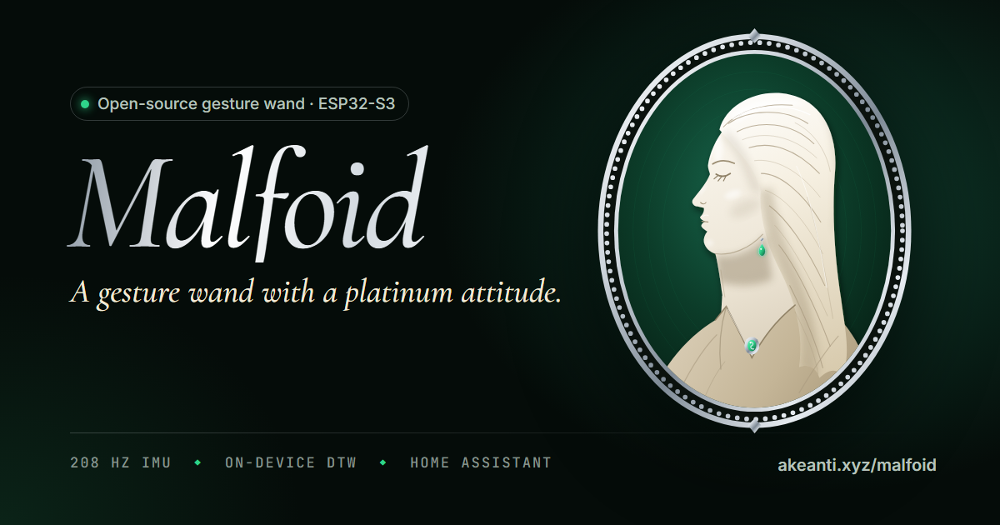

<div align="center">

<a href="https://akeanti.xyz/malfoid/"></a>

# Malfoid

**An open-source gesture wand with a platinum attitude.**

Draw a spell in the air. An ESP32-S3 and a 6-axis IMU track the tip, an on-device recognizer names the shape,
and your smart home obeys, with a haptic flourish and a glowing tip.

[](https://github.com/akeanti/malfoid/actions/workflows/ci.yml)
[](https://akeanti.xyz/malfoid/)
[](LICENSE)
[](https://github.com/sponsors/akeanti)

**[Website & live spellbook](https://akeanti.xyz/malfoid/)** · [Hardware](hardware/) · [Firmware](firmware/) · [Sponsor](#sponsor)

</div>

---

## What she does

- **Draws in the air.** A Madgwick AHRS fuses gyro and accelerometer at 208 Hz, and the firmware tracks where the *tip points* (azimuth/elevation), not raw gyro axes. Rolling your wrist mid-spell doesn't distort the shape, and a unit test proves it at 70° of roll.
- **Thinks on the wand.** Strokes are resampled to 32 points and matched with dynamic time warping in a Sakoe-Chiba band. No cloud, no ML training set, about a millisecond on the ESP32-S3. Teach her a new spell with one cast.
- **Commands your home.** MQTT with Home Assistant discovery: every spell shows up as a *device trigger*, plus battery and last-spell sensors.
- **Feels alive.** LRA haptics through a TI DRV2605L, a light-piped SK6812 tip, and deep sleep (~50 µA on the Core board, estimated) until the IMU's wake-up interrupt notices you've picked her up.
- **Configured from the browser.** The website has a Web Serial console for live orientation, cast inspection, Wi-Fi/MQTT setup and spell recording, plus a one-click browser flasher (ESP Web Tools) fed by GitHub Actions.

## The spellbook

| Spell | Gesture | Default meaning |
|---|---|---|
| **Lumen** | flick upward | lights on (the tip stays lit as a torch) |
| **Umbra** | flick downward | lights off |
| **Dextra** / **Sinistra** | sweep right / left | next / previous track |
| **Circulus** / **Retrorsum** | circle clockwise / counter-clockwise | volume up / down |
| **Serpens** | an S, top to bottom | emerald ambient scene |
| **Fulgur** | a Z | play / pause |
| **Malfoid** | an M, her signature | sterling scene, and a little drama |

"Default meaning" is just a suggestion: the wand publishes the spell name, and you decide what it does.
Spells live in [`spells/spellbook.json`](spells/spellbook.json). `python tools/gen_spellbook.py` regenerates the firmware header and the website module from it, so both always agree.

## Quick start (path A: no custom PCB)

1. **Parts:** Seeed XIAO ESP32S3, Adafruit LSM6DSOX + DRV2605L + MAX17048 breakouts (STEMMA QT), an 8 mm LRA, one SK6812, a small LiPo, and copper tape under a 3D-printed emerald. Full list in [`hardware/bom-path-a.csv`](hardware/bom-path-a.csv), wiring in [`hardware/README.md`](hardware/README.md#path-a-breakout-build).
2. **Flash:** open [the website's flasher](https://akeanti.xyz/malfoid/#flash) in Chrome or Edge and click *Install*. Or from source:
   ```bash
   cd firmware && pio run -e xiao -t upload
   ```
3. **Configure:** on the [website console](https://akeanti.xyz/malfoid/#console), click *Connect wand*, enter Wi-Fi and MQTT details, and *Save to wand*.
4. **Cast:** rest your thumb on the emerald, draw, release.

The body is a parametric OpenSCAD model in [`mechanical/`](mechanical/).

## Home Assistant

With MQTT discovery enabled (it is by default), Malfoid appears as a device with a trigger per spell. To build an automation in the UI: *Device → Malfoid → "Lumen" spell cast*. Or in YAML:

```yaml
- alias: "Malfoid: Lumen turns the lights on"
  triggers:
    - trigger: mqtt
      topic: "malfoid/+/spell"
      payload: "lumen"
  actions:
    - action: light.turn_on
      target:
        entity_id: light.living_room
```

| Topic | Payload |
|---|---|
| `malfoid/<id>/spell` | spell id, once per successful cast |
| `malfoid/<id>/state` | retained JSON: `battery`, `voltage`, `charging`, `last_spell`, `rssi` |
| `malfoid/<id>/status` | retained `online` / `sleeping` / `offline` (LWT) |

Casts made in the second or two after waking, before Wi-Fi is up, are queued and sent late rather than dropped.

## How recognition works

```
LSM6DSOX ──208 Hz──▶ gyro bias ──▶ Madgwick AHRS ──▶ tip direction ──▶ 2-D stroke (az, el)
   data-ready IRQ     (learned when      (accel gated     (wrist roll       │
   → FreeRTOS task     resting)           mid-flick)       cancels out)     ▼
                                    resample to 32 pts ──▶ normalize ──▶ DTW vs templates ──▶ accept?
                                                          (lines keep      (Sakoe-Chiba      score ≥ 0.55 and
                                                           aspect; shapes   band = 4)        beats runner-up by 0.05
                                                           squared up)
```

The thresholds were chosen with data, not vibes: [`tools/tune_recognizer.mjs`](tools/tune_recognizer.mjs) synthesizes thousands of sloppy casts (tilted ±17°, stretched up to 2×, wobbly, trimmed) plus random scribbles. Current numbers: **99.6% top-1, 97.4% accepted correctly, 0.1% accepted as the wrong spell.** CI fails if a change makes that worse.

## Repository layout

```
spells/spellbook.json      single source of truth for built-in spells
firmware/                  PlatformIO project (Arduino-ESP32 2.0.17)
  lib/malfoid_core/        hardware-free C++: AHRS, stroke pipeline, DTW recognizer
  src/                     drivers (LSM6DSOX, DRV2605L, MAX17048, SK6812, touch), sensor task,
                           MQTT + Home Assistant discovery, JSON console, deep sleep
  test/                    Unity tests, run on your PC: pio test -e native
hardware/                  design notes, power tree and calculations, BOMs, power budget
mechanical/                parametric OpenSCAD wand body
docs/                      the GitHub Pages site (spellbook demo, console, flasher)
tools/                     spellbook generator, recognizer tuner, site staging, dev server
```

## Development

```bash
pio test -d firmware -e native        # 14 C++ unit tests, including parity with the JS recognizer
pio run -d firmware                   # build the XIAO firmware (-e core for the PCB)
node tools/tune_recognizer.mjs 400    # recognizer accuracy report
python tools/gen_spellbook.py         # after editing spells/spellbook.json
python tools/serve_docs.py            # website at http://localhost:8642 (Web Serial works on localhost)
```

**Windows note:** the ESP32 toolchain can't handle paths longer than 260 characters. If a build fails with "No such file or directory" on files that clearly exist, clone the repo somewhere short like `C:\src\malfoid`.

## Sponsor

Malfoid is free and open: firmware, hardware and website, MIT licensed. If she charms you, [**sponsor on GitHub**](https://github.com/sponsors/akeanti). It pays for PCB revisions, actuator samples and the measurement gear that turns this README's estimates into real numbers. Sponsors are thanked in [SPONSORS.md](SPONSORS.md).

## Roadmap

- [ ] Malfoid Core rev A: KiCad schematic and layout from the design notes in `hardware/`
- [ ] Auto light-sleep between IMU FIFO reads (awake current: ~60 mA → ~15 mA)
- [ ] BLE mode via Home Assistant Bluetooth proxies (no Wi-Fi association needed)
- [ ] DRV2605L auto-calibration for the LRA
- [ ] Two-stroke spells (e.g. M then flick)

## Credits

The Malfoid cameo, the wand illustrations, the crest and the icons are **original artwork made for this project**, under [CC BY 4.0](https://creativecommons.org/licenses/by/4.0/). No film imagery or fan art is used. Typefaces, algorithms and libraries are credited in [CREDITS.md](CREDITS.md).

<p align="center"></p>

## License

Code is MIT, see [LICENSE](LICENSE). Artwork in `docs/assets/` is CC BY 4.0.

Malfoid is an independent, fan-inspired project, not affiliated with or endorsed by Warner Bros. Entertainment or the Wizarding World franchise. The spell names are original Latin-flavoured inventions.
