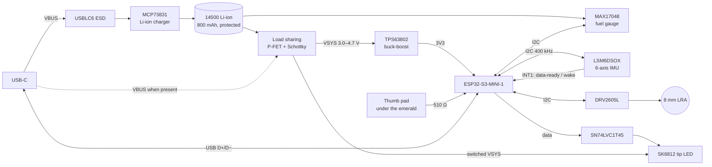

# Malfoid hardware

Two ways to build her, with the same firmware:

| | **Path A: breakouts** | **Path B: Malfoid Core PCB** |
|---|---|---|
| Who it's for | First build, no SMD soldering | The real thing |
| Brain | Seeed Studio XIAO ESP32S3 | ESP32-S3-MINI-1-N8 on a custom 18 × 92 mm board |
| Power | XIAO's built-in charger + 1S LiPo | USB-C, MCP73831 charger, load sharing, TPS63802 buck-boost |
| Deep sleep | ~1–3 mA (breakout LEDs and regulators), ~0.3 mA with LED jumpers cut | ~40–60 µA estimated |
| Firmware env | `pio run -e xiao` | `pio run -e core` |

## System block diagram

I2C addresses: **0x36** fuel gauge, **0x5A** haptics, **0x6A** IMU (0x6B if SDO is high; the firmware tries both).

---

## Path A: breakout build

Everything except the LED and thumb pad speaks STEMMA QT / Qwiic, so the I2C side is just daisy-chained cables.

| XIAO pin | GPIO | Connects to |
|---|---|---|
| 3V3 | – | STEMMA QT chain (IMU → haptics → gauge), SK6812 VDD |
| GND | – | everything |
| D4 / SDA | 5 | STEMMA QT SDA |
| D5 / SCL | 6 | STEMMA QT SCL |
| D3 | 4 | LSM6DSOX **INT1** (needs an RTC-capable pin to wake from sleep) |
| D0 | 1 | Thumb pad (copper tape under the gem), through ~510 Ω |
| D1 | 2 | SK6812 DIN |
| BAT+ / BAT− pads | – | 1S LiPo, *and* the MAX17048 breakout's battery input |

Notes:

- **Mount the IMU breakout flat with its X arrow pointing to the tip.** If you can't, change `kImuAxis` / `kImuSign` in [`firmware/include/malfoid_config.h`](../firmware/include/malfoid_config.h).
- SK6812s are specified from 3.5 V. At 3.3 V the single tip LED works fine in practice, which is why path A gets away without a level shifter. Path B does it properly.
- Cut the power-LED jumpers on the breakouts if you care about standby time. Each one burns about a milliamp, forever.
- The DRV2605L breakout has no EN pin, so it idles in standby (a few µA) instead of being switched off.

## Path B: Malfoid Core rev A

A long, thin 4-layer board that lives in the handle. Handle layout, pommel → tip:

> USB-C in the pommel face → **Core board** (power stage at the pommel end, ESP32-S3 module and antenna at the far end) → ~8 mm plastic gap for the antenna → **14500 cell**, with the 3 mm light fibre running alongside it → shaft.

### Board

- **Outline:** 18 × 92 mm, 1.0 mm, 4 layers (signal / GND / power / signal), ENIG.
- **Antenna:** the ESP32-S3-MINI-1 sits at the shaft end with its antenna past the board edge and a copper keep-out on all layers. The shaft must be non-metallic (PETG, resin, wood).
- **IMU placement:** close to the pommel end, on the board's centre line. The wrist is the pivot of most casts, so a small radius means less centripetal acceleration polluting the tilt estimate. The firmware also ignores the accelerometer whenever |a| leaves 0.85–1.15 g.
- **Thumb pad:** a 10 × 6 mm copper pour on the top layer under the 3D-printed emerald, with ground hatching around (not under) it.

### Power tree and calculations

**Charging.** MCP73831-2 (4.20 V). The charge current is set by `R_PROG`:

$$I_{REG} = \frac{1000\,\text{V}}{R_{PROG}} \Rightarrow R_{PROG} = 2.49\,\text{k}\Omega \rightarrow 401\,\text{mA}$$

That is 0.5 C for an 800 mAh 14500 cell: gentle, cool and long-lived. STAT goes to GPIO12 (low = charging) and to a small red LED from VBUS.

**Load sharing** (Microchip AN1149). The system rail (VSYS) must not be fed *through* the charger, or the charger never sees end-of-charge.

- Q1, a P-MOSFET (DMG2305UX): drain on VBAT, source on VSYS, gate on VBUS with 100 kΩ to GND.
- D1, a Schottky (e.g. PMEG2010): VBUS → VSYS.
- USB absent: the gate is pulled to 0 V, Vgs ≈ −3.7 V, and Q1 conducts so the cell feeds VSYS.
- USB present: gate = 5 V > source, so Q1 is off and VSYS comes from VBUS through D1 (~4.7 V). The body diode is reverse-biased, so VSYS can't back-feed the cell.

**3.3 V rail.** TPS63802 buck-boost, set by the feedback divider (V_FB = 0.5 V):

$$V_{OUT} = 0.5\,\text{V}\left(1 + \frac{R_1}{R_2}\right),\quad R_1 = 562\,\text{k}\Omega,\ R_2 = 100\,\text{k}\Omega \Rightarrow 3.31\,\text{V}$$

Why buck-boost and not an LDO? A Li-ion cell sags from 4.2 V to about 3.0 V, and the ESP32-S3 pulls ~350 mA peaks while transmitting. An LDO needs about 3.5 V in and gives up the bottom ~25% of the cell. The buck-boost runs the cell down to protection cut-off at ~90% efficiency. Use the inductor and capacitors from the datasheet's recommended layout, and keep the switch-node loop tiny.

**USB-C.** 5.1 kΩ from each CC pin to GND (marks the board as a sink: 5 V default USB power, no PD negotiation needed). USBLC6-2SC6 on D+/D−, 10 µF on VBUS.

### Signals

| Block | Connection |
|---|---|
| LSM6DSOX | VDD + VDDIO = 3V3 with 100 nF each; CS → VDDIO (I2C mode); SDO/SA0 → GND (0x6A); INT1 → GPIO10 (RTC) |
| DRV2605L | VDD = 3V3, 1 µF + 100 nF; EN → GPIO11 (low = shutdown); IN/TRIG → GND; OUT± → LRA via 0 Ω links (room for an EMI ferrite pair) |
| MAX17048 | VDD + CELL → VBAT; CTG, QSTRT → GND; ALRT → GPIO13 with 10 kΩ to 3V3 |
| I2C pull-ups | 2.2 kΩ to 3V3 on SDA/SCL. Rough bus capacitance: ~60 pF (3 devices + 90 mm trace). t_r ≈ 0.85 × R × C ≈ 0.11 µs, well inside 400 kHz Fast-mode's 0.3 µs |
| Tip LED | SK6812MINI-E powered from switched VSYS: a P-FET high-side switch whose gate a 2N7002 pulls low when GPIO39 is high. Off in sleep, because an SK6812 idles at ~1 mA even when dark |
| LED data | GPIO38 → SN74LVC1T45 (A side at 3V3, B side at switched VSYS, DIR → VCCA) → DIN. At 4.7 V on USB the LED needs V_IH ≈ 3.3 V, so a bare 3.3 V GPIO would be marginal |
| Thumb pad | GPIO4 (TOUCH4) through 510 Ω (ESD and noise filtering, per Espressif's touch design guide) |
| Buttons | BOOT on GPIO0, RESET on EN (10 kΩ pull-up + 1 µF) |
| Debug | USB D− / D+ on GPIO19 / GPIO20 (native USB Serial/JTAG: flashing, console, debugging, all over one cable) |

### Bring-up checklist

1. **Before the module goes on:** check the TPS63802 output is 3.30 V ±2% from a bench supply at 3.0, 3.7 and 4.2 V on VBAT.
2. Plug in USB-C with no cell: VSYS ≈ 4.7 V, and STAT LED behaviour matches "no battery".
3. Insert the cell. Charge current is ~400 mA in CC phase (measure in series), tapering at 4.2 V.
4. Flash `pio run -e core -t upload`, open the web console and press **Connect**. The hello message reports `imu`, `haptics` and `gauge` as `true`.
5. Turn on live view. Tilt the tip up and elevation should rise; turn left and azimuth should rise. If not, fix `kImuAxis` / `kImuSign`.
6. Measure sleep current with the console's **Sleep** button (use a µCurrent or a PPK2, not a multimeter on the mA range).

---

See [`power-budget.md`](power-budget.md) for battery-life estimates, and the BOMs for parts:
[`bom-path-a.csv`](bom-path-a.csv) · [`bom-core-rev-a.csv`](bom-core-rev-a.csv).
